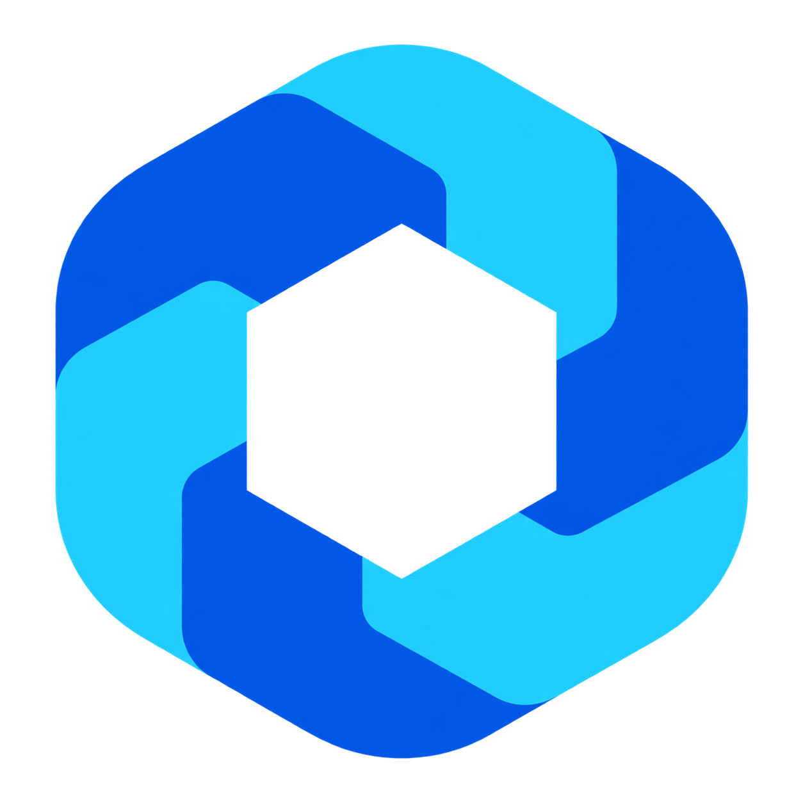

# Optimus

[Releases](https://github.com/ArkGravity/optimus/releases) · [简体中文](README_zh.md) · [Documentation](docs/README.md)

Optimus is a self-hosted infrastructure console for teams that need one place to manage access, protect credentials, inspect Kubernetes, deploy Helm applications, and browse cloud inventory. The web UI and API ship together in one Go binary, backed by PostgreSQL 17.

## What you can do

- Manage users, roles, menus and permissions with RBAC and audit records.
- Keep kubeconfigs and cloud credentials in an AES-256-GCM encrypted vault.
- Inspect Kubernetes workloads, resources and logs with read-only inspection APIs.
- Manage Helm applications and releases.
- Collect read-only inventory from AWS, Aliyun and GCP, with shared filters and resource details.
- Use the English or Simplified Chinese UI, with light and dark themes.

| Provider | Inventory |
| --- | --- |
| AWS | EC2 instances, VPCs/subnets, Security Groups, RDS |
| Aliyun | ECS instances, VPCs/subnets, Security Groups, RDS |
| GCP | Compute Engine instances, VPCs/subnets, firewall rules, Cloud SQL |

Assets navigation is **Cloud Accounts → VPCs → Firewalls → Instances → Databases → Sync Runs**. Collection uses selected credentials and does not provide cloud resource write or management APIs. Dashboard and Observability Center are Coming Soon placeholders.

## Install and sign in

Use Docker Compose for a bundled PostgreSQL deployment, or a Linux binary with an existing PostgreSQL 17 server. Go and Bun are only needed for development.

**[v0.1.2 is published](https://github.com/ArkGravity/optimus/releases/tag/v0.1.2), released on 2026-11-12 (UTC).** Native Linux amd64/arm64 archives, the deployment package and both registries passed [artifact verification](https://github.com/ArkGravity/optimus/actions/runs/43303096304/attempts/2) and independent post-publication checks. Download the release attachments using the [installation guide](docs/installation.md).

1. Follow the [Docker Compose or native installation guide](docs/installation.md). Generate independent database, JWT and vault secrets before starting a shared environment.
2. Open `http://127.0.0.1:8080` locally, or the HTTPS address configured through your reverse proxy.
3. Sign in with the bootstrap username (`admin` by default; configurable through `OPTIMUS_BOOTSTRAP_ADMIN_USERNAME`) and the password printed once by seed. For Compose, retrieve it with `docker compose logs seed` and store it securely.

Keep the database backup and its matching vault key together in your recovery plan. Losing the vault key makes encrypted credentials unrecoverable.

## Connect your first resources

For cloud inventory, create a **Cloud Key** with AWS/Aliyun AK/SK or GCP Service Account JSON, then create a **Cloud Account** with that credential, its provider and selected regions. GCP also requires an explicit target Project ID, which may differ from the credential's home project. Run **Sync**, check **Sync Runs**, then inspect VPCs, Firewalls, Instances and Databases. Use read-only provider permissions; the [AWS](scripts/p4-smoke.md) and [multi-cloud](scripts/p4-multicloud-smoke.md) checklists describe the required access and validation steps.

For Kubernetes, store a kubeconfig in the vault and add a cluster referencing it. Kubeconfigs with `exec` or `auth-provider` plugins are rejected. Choose the cluster inside Kubernetes pages to begin inspection.

The operator confirmed real AWS, Aliyun and GCP acceptance of `main-1bbb8fe` on 2026-11-05. This operator report is separate from automated verification of the versioned release artifacts. See the [release notes](docs/releases/v0.1.0.md).

## Database baseline

Current main uses a fresh 19-migration baseline: 31 business tables plus Goose history. Existing databases at historical schema 00022, 00023 or 00028 cannot upgrade in place using these renumbered migrations. Read the [database transition and recovery guide](docs/operations/recovery.md) before using an existing database. Recreating a container does not recreate its PostgreSQL data.

## Documentation and development

- [Install / 安装](docs/installation.md) · [中文安装指南](docs/installation_zh.md)
- [Documentation index](docs/README.md) · [API specification](docs/api/swagger.json) · [Permissions](docs/permissions.md)
- [Developer setup](docs/development/getting-started.md) · [CI](docs/development/ci.md) · [Release process](docs/development/releases.md)
- [Contributing](CONTRIBUTING.md) · [Security reporting](SECURITY.md)

Optimus uses Go 1.25, Vue 3, TypeScript, Ant Design Vue and Bun. Build the embedded UI and binary with `make build`; see the developer guide for local configuration and checks.

## License

Optimus is available under the [MIT License](LICENSE). Copyright © 2026 ArkGravity contributors.
