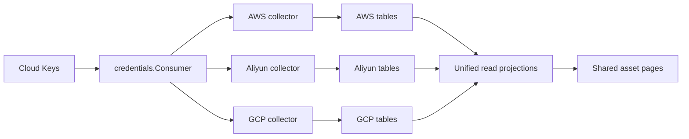

# Multi-cloud Assets Design

## Approval and delivery state

The operator approved this architecture on 2026-10-28 after two rounds of
research. The final correction is **`gcp_databases`** for GCP database storage.
The implementation branch is `feat/multicloud-assets`, based on
`3bd0add47e4f333d7984e8164010fc04de3c3037`. Baseline CI
[40702433368](https://github.com/ArkGravity/optimus/actions/runs/40702433368)
passed all six jobs, including image publication. This does not establish
production acceptance of that image: the last operator-confirmed production
baseline remains `d0016d0`, schema 00022.

This document records the approved scope and concrete implementation contracts.
The accompanying implementation plan tracks execution. Creating this document
does not authorize a commit, push, merge, deployment, or application DB reset.

## 1. Product scope

Menu order and English labels are fixed:

1. Cloud Accounts
2. VPCs
3. Firewalls
4. Instances
5. Databases
6. Sync Runs

Cloud Keys keeps its current label. Firewalls has one list and one detail
experience; no provider-specific category menus or Security Groups versus
Firewall Rules category tabs. Direction tabs inside rule details remain useful.
VPCs remains the first resource menu after Cloud Accounts.

| Family | AWS | Aliyun | GCP |
|---|---|---|---|
| Instances | EC2 instances | ECS instances | Compute Engine VM instances |
| VPCs | VPCs and subnets | VPCs and vSwitches | VPC networks and subnetworks |
| Firewalls | Security groups with rules | Security groups with rules | VPC firewall rule resources |
| Databases | Existing RDS DB instance scope | ApsaraDB RDS instances | Cloud SQL instances |

Discovery remains read-only. SQL logins, SSH, provisioning, resource mutations,
PolarDB, Spanner, AlloyDB, WAF, AWS Network Firewall, dedicated Cloud Firewall
products, effective-policy evaluation, organization discovery and GCP
hierarchical/network firewall policies are outside this increment.

## 2. Architecture and ownership



Keep the existing AWS tables and IDs. Add independent provider/family tables;
do not create per-account tables or a second materialized copy of all assets.
Common scheduling, account locks, permission enforcement and audit remain shared.
Provider collectors own SDK calls, native mapping and typed persistence.
The shared engine must not expose AWS SDK clients in its provider interface.

| Concern | Location |
|---|---|
| Auth input, encryption, rotation, deletion | `internal/modules/credentials/cloudkey/` |
| Decrypted credential boundary | `internal/modules/credentials/consume.go` |
| Shared account/target scope and eligibility | `internal/modules/assets/account/` |
| Provider-neutral identifiers, locations and rule DTOs | `internal/modules/assets/resource/` |
| Provider discovery and persistence | `internal/modules/assets/providers/aws|aliyun|gcp/` |
| Common orchestration and run recording | `internal/modules/assets/sync/` |
| Unified SQL reads | `internal/modules/assets/query/` |
| HTTP family DTOs/services/handlers | existing `instance`, `vpc`, `database`; new `firewall` |
| Composition | `internal/modules/assets/module/wire.go`, then `cmd/optimus/server.go` |

Retain `awsclient` and the existing AWS fetch/persistence helpers behind an AWS
adapter rather than rewriting working collectors. The existing `securitygroup`
package remains the legacy AWS HTTP adapter during this increment.

## 3. Authentication

Optimus is always treated as an externally deployed, provider-independent
application. Every connection uses its selected vault record explicitly.

| Provider | Accepted authentication | Required secret input |
|---|---|---|
| aws | `access_key` | `access_key_id`, `secret_access_key` |
| aliyun | `access_key` | `access_key_id`, `secret_access_key` |
| gcp | `service_account_json` | `service_account_json` |

Do not add default ADC, instance metadata, WIF, OIDC, external command providers,
AssumeRole, credential URLs or CLI dependencies in this increment. Use the
official SDKs with explicitly constructed credentials. GCP's OAuth scope is
`https://www.googleapis.com/auth/cloud-platform`; read-only access is enforced
by the target project's IAM permissions and by the implemented API calls.

### 3.1 Storage and compatibility

Extend the shared `credentials_cloud_keys` table with:

- `auth_type VARCHAR(32) NOT NULL`;
- `service_account_json_enc BYTEA NULL`;
- `service_account_email TEXT NOT NULL DEFAULT ''`;
- `credential_project_id TEXT NOT NULL DEFAULT ''`.

Keep current AK/SK ciphertext columns, making them nullable for GCP's JSON shape.
Allowed stored shapes are:

| Provider/auth_type | AK/SK ciphertext | SA JSON ciphertext |
|---|---|---|
| aws or aliyun / access_key | both non-NULL | NULL |
| gcp / service_account_json | both NULL | non-NULL |
| gcp / legacy_invalid | both non-NULL | NULL |

The last shape preserves old GCP records which only contain AK/SK. It is a
migration-only state: reject new records with that auth type; expose
`needs_configuration: true`; refuse their consumption and account binding.
Metadata edits and deletion remain available. Uploading a valid SA JSON repairs
the record atomically and clears its old AK/SK ciphertext. No SQL decrypts or
reencrypts secrets. AWS/Aliyun ciphertext is retained byte-for-byte.

New API requests may omit `auth_type`; derive it from provider for compatibility.
If it is supplied, it must match the matrix. Secret fields are conditional,
not unconditionally required by Gin tags. A type/provider conversion on an
unreferenced record requires a complete new secret shape and clears old secret
columns. A live Cloud Account prevents provider/auth-type conversion, including
when the account is disabled. Rotation within the same type remains supported.

Keep `credentials.Consumer` as the sole downstream API. Extend `CloudKey` with
`AuthType string` and `ServiceAccountJSON []byte`. `Wipe` overwrites this byte
slice before clearing it and preserves the existing best-effort string cleanup.
No decrypted material is returned by credential GET/list or written into audit,
errors, browser storage, workspace state or temporary files.

### 3.2 SA JSON validation

Limit input to 64 KiB; reject duplicate JSON object keys and multiple documents.
Require `type == "service_account"`, a nonempty syntactically valid
`client_email`, a parseable RSA private key and nonempty `project_id`. If present,
`token_uri` must be exactly `https://oauth2.googleapis.com/token` and
`universe_domain` must be `googleapis.com`. Construct a canonical payload from
the allowed fields: type, project_id, private_key_id, private_key, client_email,
client_id, token_uri and universe_domain. Set the token endpoint explicitly in
the runtime client. Reject other credential types before invoking auth libraries.
Accept standard downloaded-key metadata auth_uri,
auth_provider_x509_cert_url and client_x509_cert_url, but discard those fields
from the canonical payload and never follow their URLs. Duplicate-key checking
also covers discarded metadata. Do not reject an ordinary downloaded SA key
merely because it contains these standard fields.

Import performs local validation. The first explicit sync verifies cloud access;
there is no hidden network request during a metadata edit or JSON upload.
Token refresh is owned by the official auth library within a sweep's client
lifetime. Rotation replaces stored JSON and later sweeps use the new material.

## 4. Cloud Accounts and target identity

Continue sharing `cloud_accounts`. Add:

- `project_id TEXT NOT NULL DEFAULT ''`: required only for GCP;
- `external_account_id TEXT NOT NULL DEFAULT ''`: verified AWS/Aliyun account ID;
- `scope_revision BIGINT NOT NULL DEFAULT 1`: increments on enabled-region changes.

GCP uses one project per Cloud Account, with a reusable credential. JSON's
credential project is identity metadata, not the collection target. Provider,
project and credential binding remain immutable on existing connections for
this increment; replace the connection to change its target. Secret rotation
on its referenced credential does not require replacing the connection.

Validate credential provider/auth type inside the same credential advisory lock
used by account create/delete/credential deletion. An existence-only check is
insufficient. Resolve AWS/Aliyun account identity with read-only STS
GetCallerIdentity before resource enumeration; atomically pin an empty account
ID on first successful resolution. Later sweeps must match it. A mismatch records
a safe configuration failure, without publishing or pruning any resource.
Because every unit consumes fresh credential material and same-type rotation is
allowed, AWS/Aliyun collectors also verify each unit key's STS identity against
the pinned account before enumerating resources. A key rotated mid-sweep must
not redirect a later unit into another cloud account. Identity failure stops
further calls; GCP remains bound to its explicit target project.

Require one or more explicit enabled regions for all providers. Fetch region
options from authenticated provider catalogs via
`GET /assets/cloud-accounts/region-options?provider=...&cloudkey_id=...&project_id=...`.
Gate this by `assets:account:write`, audit the credential consumption purpose,
and use a fresh client. Keep existing AWS region validation behavior where
possible, but do not use its regex for Aliyun/GCP. Region selection is never an
implicit all-regions scan. Listing region options does not modify cloud resources.

Global GCP networks and VPC firewall resources are included once per project,
while subnet/VM/database snapshots are limited to the configured regions.
Keep full network references, including host-project references in Shared VPC;
an uncollected referenced network is displayed as an external reference rather
than attached to a same-named local network. Automatic host-project discovery
is outside scope.

## 5. Provider-native tables

| Family | AWS | Aliyun | GCP |
|---|---|---|---|
| Instance | aws_instances | aliyun_instances | gcp_instances |
| VPC | aws_vpcs | aliyun_vpcs | gcp_networks |
| Subnet | aws_subnets | aliyun_vswitches | gcp_subnets |
| Database | aws_databases | aliyun_databases | **gcp_databases** |
| Firewall | aws_security_groups | aliyun_security_groups | gcp_firewalls |

Each new table has BIGSERIAL id; restrictive cloud_account_id FK; native ID as
TEXT; relevant region/zone/network references; typed family fields;
JSONB tags/labels and allowlisted native detail; last_seen_at, created_at,
updated_at and deleted_at. Do not use default zero/false to invent unsupported
facts. Queryable list fields use typed columns, and JSONB is for structured
collections/native extras, not an unvalidated dump of an SDK response.

Common family fields required on new tables:

| Family | Required fields beyond lifecycle/account identity |
|---|---|
| Instance | instance_id, name, instance_type, native_status, region, zone, network_interfaces JSON array, tags JSON object, native_details JSON object |
| VPC/network | network_id, name, region (empty for global), cidr_blocks JSON array, native_status, tags, native_details |
| Subnet/vSwitch | subnet_id, network_ref, name, region, zone, cidr_blocks, tags, native_details |
| Database | database_id, name, product, engine, engine_version, instance_class, native_status, region, zone, endpoints JSON array, storage_gb nullable BIGINT, ha_mode nullable TEXT, publicly_accessible nullable BOOL, tags, native_details |
| Firewall | firewall_id, name, network_ref, region (empty for global), description, inbound_rules JSON array, outbound_rules JSON array, tags, native_details |

Aliyun uniqueness is `(cloud_account_id, region, native family ID)`; VM rows
also preserve zone. GCP instances use `(cloud_account_id, zone, instance_id)`,
networks/firewalls use `(cloud_account_id, native family ID)` and regional
subnets/databases use `(cloud_account_id, region, native family ID)`.
Indexes cover account/location, network refs, last_seen and live ordered reads;
GIN indexes cover tags and searchable address collections where used.

Network interfaces preserve their network/subnet references and internal,
external, IPv4 and IPv6 address arrays. IP search checks all interfaces using
validated address equality, not substring matching. Existing AWS scalar address
columns project as zero/one-element arrays; this increment does not require
backfilling AWS secondary NICs from a new API scope.

For consistent persistence/query/collector boundaries, shared interface JSON
uses id, name, network_ref, subnet_ref, private_ipv4, public_ipv4,
private_ipv6 and public_ipv6. Each address field is a string array. Database
endpoint JSON uses address, nullable port and type, preserving native endpoint
type separately when normalization is needed. Define these shared Go value
types in resource/network.go and resource/database.go. New network tables also
keep native_ref TEXT: Aliyun uses its VPC ID; GCP uses the full project-qualified
network resource path. Subnet/interface/firewall network_ref uses that same
canonical reference, retaining Shared VPC host projects. Native numeric IDs
remain separate strings; never join a GCP network's numeric ID to a self-link.

Do not store user-data, startup scripts, arbitrary VM metadata, SSH private
material, OAuth tokens or database passwords in native_details. Unknown CPU,
memory and storage remain NULL/absent; do not guess from a small spec-name map.

## 6. Unified reads and public identity

Define common projections in `internal/modules/assets/query/`, one family per
file. Use static SQL `UNION ALL`, with trusted provider source definitions;
never interpolate a user-supplied table name. Filtering, count and pagination
operate over the combined relation. Order by live rows first, last_seen_at DESC,
provider ASC, id DESC. Provider selection prunes branches before querying.
Use a read-only repeatable-read transaction for matching count/page snapshots.
Do not add materialized views, a new cache or a second asset index table.

All public summaries add:

```json
{
  "id": 42,
  "asset_key": "gcp:instance:42",
  "provider": "gcp",
  "cloud_account_id": 7,
  "project_id": "production-apps",
  "location_type": "zone",
  "location": "us-central1-a",
  "region": "us-central1",
  "zone": "us-central1-a",
  "native_id": "1234567890123456789",
  "native_status": "RUNNING"
}
```

`id` remains the provider table row ID for AWS compatibility. `asset_key` is
`<provider>:<family>:<positive decimal row ID>`, with provider in aws/aliyun/gcp,
family in instance/vpc/subnet/database/firewall and ID <= MaxInt64. Numeric
legacy detail IDs mean AWS only. The browser uses asset_key for rows and links.
Native IDs always remain strings, including GCP uint64 IDs. This public identity
is distinct from natural-key uniqueness in storage.

List filters are provider, account_id, project_id, region, zone, q,
include_deleted, page and size (1..200), plus existing family filters.
Add exact `ip` and `tag_key`/`tag_value` filters for Instances, and VPC/network
filters where applicable. Search text is parameterized; native filters use
allowlisted fields. Preserve existing summary properties as aliases where they
already exist; add common names rather than silently changing their meaning.
Return null/absent for unsupported facts. Normalized instance states are running,
stopped, suspended, pending, stopping, error, terminated and unknown. In GCP,
TERMINATED maps to stopped; local soft deletion is independent of cloud state.

Canonical HTTP routes under `/api/v1/assets`:

| Route | Behavior |
|---|---|
| GET /instances | Unified paginated instance list |
| GET /instances/:asset_key | Provider-specific instance detail in common envelope |
| GET /vpcs | Unified VPC list |
| GET /vpcs/:asset_key | Common plus native VPC detail |
| GET /vpcs/:asset_key/subnets | Subnets scoped by the selected network's account, full native ref and location |
| GET /databases | Unified database list |
| GET /databases/:asset_key | Common plus native database detail |
| GET /firewalls | Unified firewall list |
| GET /firewalls/:asset_key | Rules and native detail |

Preserve `/security-groups` and `/security-groups/:id` as AWS-only legacy API
adapters. Existing `/vpcs/:id/subnets` numeric links continue to work through
the same parser, without registering conflicting Gin wildcard routes.
All family reads use nested `assets:resource:read` middleware groups.

Extend the non-HTTP assets.Consumer with scoped private-IP instance lookup
across provider tables. Search all private NIC IPv4/IPv6 addresses, preserving
the existing private-only lookup semantics; the general Instances IP filter
may match private or public addresses. Add optional account and network filters
to a new scoped method; the old IP-only method returns a new explicit ambiguity error when multiple
live matches exist, instead of choosing the latest row. Keep
ErrAssetsInstanceNotFound for zero matches and no audit side effects on reads.

## 7. Firewalls rendering contract

One firewall resource means one native security group for AWS/Aliyun, or one
native VPC firewall resource for GCP. A GCP resource may contain several
protocol/port entries; normalize these into displayed rule entries, preserving
the native resource as the parent. Counts mean displayed entries, not a claim
that cloud quotas or effective traffic policy are identical.

Rules carry direction, protocol, nullable ports, target type/value and description.
Extend with action (allow/deny), nullable priority, nullable enabled,
source/destination ranges, source/target network tags and service accounts.
Provider-only information remains available in typed native detail. Unsupported
priority/enforcement is null, not a fabricated number or boolean. IPv4/IPv6,
prefix-list/group refs and ICMP type/code zero or wildcards remain intact.
GCP network tags remain separate from GCP labels and Resource Manager tags.

## 8. Synchronization and lifecycle

The shared engine plans units through a provider registry. A unit has a stable
key, resource_type, location_type/location, region, captured scope_revision and
bounded timeout. The provider returns a deferred persistence closure only after
all relevant pages and required detail calls have completed successfully.
The engine invokes that closure inside one account-locked transaction after
rechecking liveness, enabled status, provider, target and scope_revision.
Do not accept arbitrary closures from HTTP; these are internal adapter values.

| Provider | Units |
|---|---|
| AWS | instance, network, database, security_group per enabled region; preserve network/subnet atomic transaction |
| Aliyun | instance, network, database, security_group per enabled region; VPC/vSwitch snapshots atomic |
| GCP | global network; subnet per enabled region; instance per enabled zone discovered under enabled regions; database per enabled region; global firewall |

Preserve existing resource_type values and add subnet/firewall/planning. The display
labels use Firewalls for security_group and firewall. A failed GCP zone discovery
cannot make missing zones authoritative. Existing terminal run statuses remain
success/failed/skipped: partial pagination/detail/aggregated-list responses
fail the affected unit with zero writes and zero deletions. Failed account
identity or zone-catalog planning records a failed planning run before any
publication; unseen scopes are never interpreted as empty. Other independent
units continue. Authentication/identity failure can fail all planned units
without repeatedly contacting the same invalid identity.

GCP network collection is global and independent from regional subnet pruning;
do not claim it shares AWS's regional network transaction. Prefer scoped VM
list requests after authoritative zone discovery. If aggregatedList is used,
unreachables and failure warnings prevent affected scope publication; a
documented NO_RESULTS_ON_PAGE warning alone is not a failure.

Upsert by native uniqueness, revive soft-deleted rows without changing their
row IDs, and prune missing rows only after a complete successful unit. Empty
successful units delete missing snapshots; unchanged units are successful.
Stopped, suspended and no-public-IP instances remain inventory resources.

Account deletion cascades all provider tables transactionally. Removing regions
cleans regional/zonal resources only, increments scope_revision and retains GCP
global networks/firewalls. Account/credential references and historical sync
runs retain existing deletion behavior. A stale in-flight sweep may not revive
resources after an account/scope change.

Use fresh SDK clients per unit, bounded calls, retry budget <=3 attempts and
context cancellation. Credentials come from Consumer with a purpose including
account, provider, unit and trigger; cron uses the system prefix. Cron writes
sync runs, not additional mutation audit rows. Manual trigger retains its
single synchronous audit and asynchronous response; worker owns lock release
and shutdown cancellation. Derive manual deadline from planned unit budgets,
including global units and discovered zones, with overflow checks and a bounded
account-wide deadline; use `assets.sync_timeout` default 15m as the ceiling.

## 9. Configuration, errors and permissions

Add `assets.request_timeout` / `OPTIMUS_ASSETS_REQUEST_TIMEOUT`, default 30s,
for new providers, and `assets.sync_timeout` / `OPTIMUS_ASSETS_SYNC_TIMEOUT`,
default 15m. Keep `assets.aws_request_timeout` / existing AWS env override
effective for AWS to avoid silently changing existing deployments. AWS and new
timeouts share validation, with all new aliases documented in .env.example,
configs/config.yaml and Compose env forwarding. Scheduling/retention remain shared.

Retain AWS numeric error codes 43102..43107. Add provider-neutral codes
43201 Unauthorized, 43202 Forbidden, 43203 Unreachable, 43204 Throttled,
43205 Config, 43206 Partial, 43207 APIDisabled, 43208 Other and
43209 IdentityMismatch; generic validation/not-found/conflict keep their existing
codes. Distinguish OAuth token acquisition failures from target API permission
failures. Never persist tokens, keys, full API bodies or raw SDK errors as
client-facing run messages. Log only sanitized structured context.

Reuse existing assets:account:read/write/delete, assets:resource:read,
assets:sync:read and credentials:cloud_key:* permissions. Keep current Consumer
permission semantics rather than adding a new :use gate inside it. Provider
filters are not row authorization. New data-scope RBAC is outside this increment.

## 10. Frontend

Shared resource filters: provider, account/project, location and family options;
provider/account changes clear incompatible dependent filters and reset page 1.
Fetch account options only with assets:account:read; retain the numeric account
fallback for resource-only readers. Cloud Account write forms use authenticated
region options instead of AWS constants. GCP target Project ID is a separate
input from the credential's home project.

Preserve current view directories for Instances, VPCs and Databases. Add
`web/src/views/assets/firewalls/List.vue` and common detail renderers. Redirect
the old security-groups browser URL to Firewalls under resource-read permission.
The seed upgrades the built-in security-group menu to assets.firewalls while
preserving its row identity; repeated seed does not duplicate old/new menu rows.
Update menu fixture, static detail routes and zh-CN/en-US together.

Use asset_key for table row keys and navigation. Lists show provider and target
account/project; region/zone/global are distinct. Unsupported values use the
localized not-applicable display, and all IP addresses remain accessible in
details. Use common and typed native detail renderers, not raw JSON dumps.
Retain only approved filter/pagination/scroll state. Clear credential drafts
and detail data on close/unmount; reject late requests overwriting a new
provider/account selection or reopened drawer.

## 11. Migrations and acceptance

**Current supersession (2026-11-05, operator approved):** the source now uses
exactly 19 fresh sequential migrations, ending at 00019; next new migration is
00020. Final credential/account/provider/sync schemas are defined directly in
their owning CREATE files, preserving all 31 business tables, named constraints,
indexes and runtime/API/UI compatibility, including the allowed legacy_invalid
GCP shape. Historical GCP/run backfill DML and intermediate auth downgrade
guards are removed. SSH, kubeconfig, clusters, chart repos and applications
retain separate ownership migrations. This supersedes this section's original
00024–00028 sequence, unchanged-old-migrations and in-place upgrade statements
below. Existing databases must be actually recreated, including
goose_db_version, before migrate + seed; container recreation is insufficient.
Down drops owned tables after dependants and is not rollout recovery. This
source task does not mutate application/Dev/Production data, authorize delivery,
or establish new production acceptance; last accepted remains d0016d0/schema22.
The original sequence below is retained as dated feature-design history.

| Migration | Responsibility |
|---|---|
| 00024_cloud_key_auth_types.sql | Typed credential storage, legacy GCP preservation, shape constraints |
| 00025_cloud_account_multicloud_scope.sql | Project/account identity and scope revision |
| 00026_aliyun_assets.sql | Five Aliyun resource tables |
| 00027_gcp_assets.sql | Five GCP resource tables, including gcp_databases |
| 00028_assets_sync_scope.sql | Run provider/location/revision fields and history backfill |

Use repository SQL projections rather than requiring another migration for
query views. Existing migrations 00014/00021/00022/00023 remain unchanged.
Upgrade the accepted schema by migrate + seed. Refuse credential downgrade if
valid SA JSON records exist; do not silently delete them. Resource-table
downgrades are data-destructive Goose operations and not part of production
rollout. No operator data reset is authorized by this design.

Acceptance requires migration preservation, real PostgreSQL projection/paging
tests, SDK-over-HTTP fixtures, race tests, credential/audit/ref-lock regression,
HTTP 401/403/200, frontend tests/locale parity and an embedded build. Real cloud
smoke needs separately supplied disposable read-only accounts; mock tests do
not establish real-provider acceptance. Test fixtures must not contain real
keys, imported private JSON or cloud identifiers from private environments.

## 12. Research references

- [AutoOps native collector](https://github.com/opsre/AutoOps/blob/7bdd4f8c037f8e964353632bc71f9ab0a36eb9cb/v4/autoops-api-v4/common/util/aliyuncloud_service.go)
  and [host model](https://github.com/opsre/AutoOps/blob/7bdd4f8c037f8e964353632bc71f9ab0a36eb9cb/v4/autoops-api-v4/api/cmdb/model/cmdbHost.go):
  borrow provider separation and common presentation. Do not copy Running-only
  import, instance-ID-only deduplication, partial results reported as complete,
  localStorage secrets or guessed hardware defaults.
- [Aliyun Go credential configuration](https://www.alibabacloud.com/help/en/sdk/developer-reference/v2-manage-go-access-credentials).
- [Google externally supplied credentials](https://docs.cloud.google.com/docs/authentication/client-libraries#security_requirements_when_using_credential_configurations_from_an_external_source).
- [GCP VPC scope](https://docs.cloud.google.com/vpc/docs/vpc),
  [firewall rules](https://docs.cloud.google.com/firewall/docs/firewalls), and
  [partial aggregated instance results](https://docs.cloud.google.com/compute/docs/reference/rest/v1/instances/aggregatedList).
